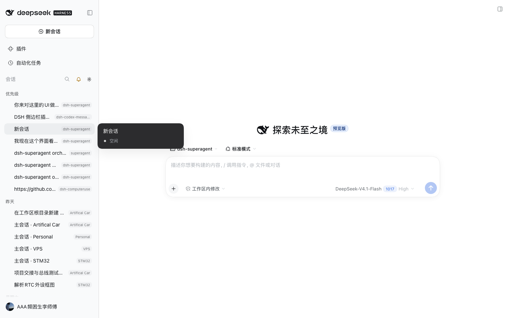
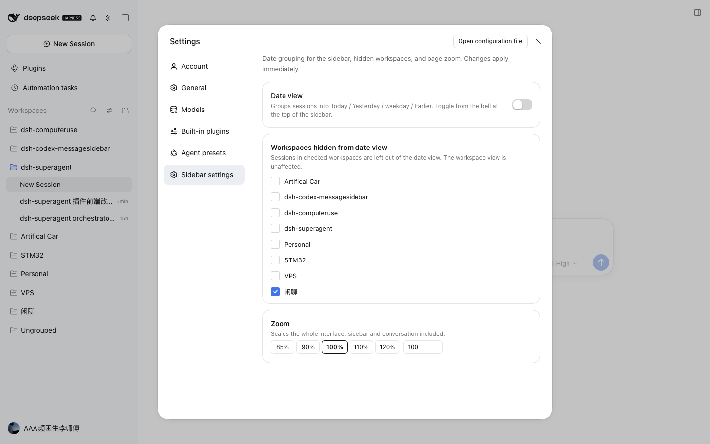
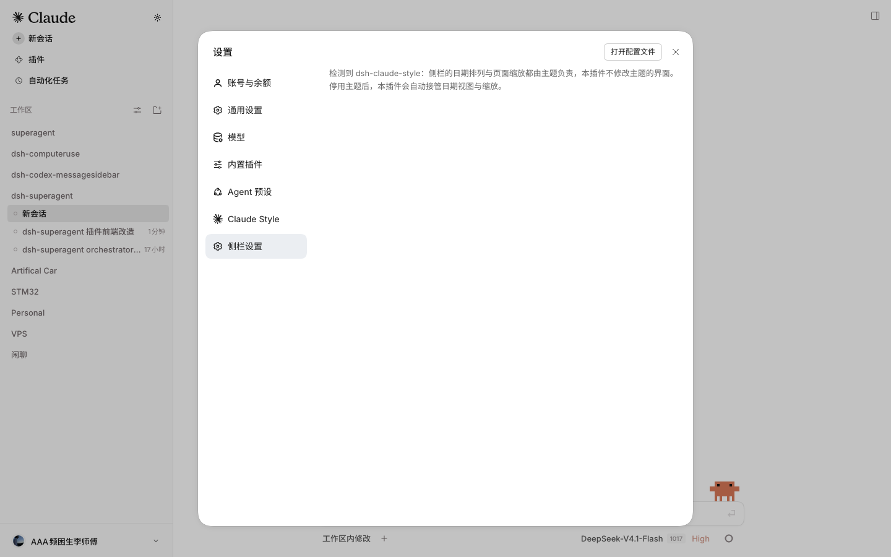

# dsh-codex-sidebar

DSH（DeepSeek Harness）左侧栏的「日期视图」插件：把会话列表按 **今天 / 昨天 / 星期X / 更早**
重新分段排列，顶行加一个铃铛按钮切换，齿轮直接跳到官方设置页里的「侧栏设置」。

拿到的是一个**独立插件**，不依赖任何主题或皮肤插件；装了 `dsh-claude-style` 时它检测到主题就会让位（见下）。



## 功能

- **按日期分段**：把宿主切到扁平分组，再按更新时间把会话重新排进日期段落，段落之间插标题。
- **运行中的会话强制「今天」并排在最前**：正在看的会话不会因为更新时间早而被埋进「更早」。
- **工作区标签**：扁平后没有分组标题了，每行右侧补一个工作区名标签，告诉你这个会话属于谁。
- **铃铛开关**：顶行铃铛切换日期视图；日期视图开着时常亮。有会话在跑时亮一个小绿点（不写数字）。
- **默认不接管**：装好后侧栏仍是宿主原本的工作区视图，只有按下铃铛才切到日期视图；选择会记住。
- **屏蔽工作区**：设置页里勾掉的工作区不进日期视图（默认屏蔽标题为 `闲聊` 的工作区）。
- **整体缩放**：4 个固定档位（80% / 100% / 125% / 150%）+ 自定义数字框（60% ~ 200%）。优先走窗口级
  page zoom，拿不到就用页面 CSS 缩放并给 body 上的浮层做补偿，细节见「整页缩放」。
- **与 dsh-better-sidebar 共处**：它的停靠按钮、底部面板、右侧栏都挂在 body 上（不在 `#root` 里），
  页面 CSS 缩放时由 `src/portal-fit.js` 单独补放大 —— 125% 下位置、字号、圆角都跟界面一致。
- **设置进官方设置页**：三张卡片（日期视图、屏蔽工作区、整体缩放）注册成官方设置页的一个 section，不是自建浮层。
- **随界面语言**：段落标题与设置页文案跟随宿主语言（中文 / 英文）。宿主语言比插件晚就绪
  或中途切换时会自动跟上（订阅 locale 服务快照 + 短暂轮询兜底，见 `src/locale.js`）。



## 安装

插件目录就是本仓库，直接装到一个 DSH profile 里：

```bash
node scripts/install.mjs --profile codexprobe                     # 装
node scripts/install.mjs --profile codexprobe --uninstall        # 卸
```

脚本做三件事（都可手工完成）：

1. profile 的 `cordis.patch.yml` 里加一条 insert（id `ui-codex-sidebar`）；
2. profile 的 `package.json`：`dsh.profile.bundles` 里加 `dsh-codex-sidebar`，`dependencies` 里加 `"dsh-codex-sidebar": "link:<本目录>"`；
3. profile 的 `node_modules/dsh-codex-sidebar` 指向本目录的符号链接。

装完重启宿主生效。桌面 App 关窗不会退进程，要用 **Cmd+Q** 退出后重开。

> 桌面 App 自己管理的 profile（`desktop`）不能靠 `dsh --profile desktop` 启动，改了它的
> bundles 之后同样只能 Cmd+Q 重开。

## 与 dsh-claude-style 的共存

`dsh-claude-style` 主题里内置了一份同样的「铃铛 + 日期分组」特性，还自带整页缩放（配置项 `pageZoom`，
桌面 App 里是 115%）。两件事都由主题做完了，本插件在检测到主题时**整体让位**：

| 模式 | 什么时候 | 行为 |
| --- | --- | --- |
| `solo` | 没装主题 | 铃铛 + 齿轮，日期视图与缩放全功能 |
| `dormant` | 装了主题 | 只挂齿轮（外加一颗铃铛）；铃铛点的是**主题自己的**日期视图（同一个功能，让它管），
  本插件不碰列表、不写任何缩放标记 |

判定只看主题的公开痕迹：`body` 上有 `data-dsh-claude*` 属性，或页面上有 `dsh-claude-` 前缀的类名。
让位时设置页只显示一句说明（不再提供会改动主题界面的开关）：



### 为什么不让两边各排各的

- 主题把侧栏工作区列表换成了自己的 provider，会盯着分组状态：一旦看到 `flat` 就认为不是自己写的、
  立刻改回工作区。两边同时动同一批座位节点，会互相还原 `display`、抢 `groupBy`。
- 主题的缩放不只是 `zoom`：它还按倍率写页面尺寸变量，并把宿主弹出的浮层按倍率搬位置
  （`page-scale` 里的 scaled layer）。独立插件复刻不了「搬浮层」那一层，硬接管只会让浮层错位。

## 整页缩放

缩放分两条路，优先用**窗口级**，拿不到才退回**页面 CSS**：

1. **窗口级**（`lib/index.js` 的 `/codex-sidebar/api/zoom`）：宿主半边调 Electron 的
   `webContents.setZoomFactor()`。这是浏览器自己做的缩放，布局、`position: fixed`、body 上的浮层
   一起放大，没有任何坐标换算问题。
   实测结论：**现在的桌面宿主做不到** —— 宿主进程带 `ELECTRON_RUN_AS_NODE=1`，插件 `require('electron')`
   拿到的是路径字符串；宿主 `lib/main.js` 里只有 `getZoomFactor()`（给菜单换算坐标用），没有
   `setZoomFactor`；`ipcMain` 频道表里也没有任何 zoom 通道。所以这条路由保留（网页版返回
   `{"supported":false}`，将来宿主放开会自动生效），实际生效的是下一条。
2. **页面 CSS**：`body[data-codex-sidebar-page-zoom] #root { transform: scale(倍率); width/height = 视口 ÷ 倍率 }`。
   用 `transform` 而不是 `zoom` 是实测结论：宿主和第三方插件都用 `getBoundingClientRect` 的**视觉像素**
   给 body 上的浮层摆位，`transform` 下这些数值仍然正确；换成 `html/body { zoom }` 后账号菜单会被算到
   视口下方（`y=898 > 900`），「缩放到 125% 后设置页打不开」就是这么来的。
3. **浮层补偿**（`src/portal-fit.js`）：`transform` 不在 body 上那些浮层的祖先链里，它们的「位置」对、
   「大小」却停在 100% 尺度（弹层字小一圈、`dsh-better-sidebar` 的底部面板压到输入框上）。
   做法：给浮层根节点（含 `body > static 跳板 > fixed 容器` 这种挂法）补 `zoom: 倍率`，
   把子树里行内写的 `left/top/right/bottom` 除以倍率，满屏浮层再写 `width/height = 视口 ÷ 倍率`。
   宽度/高度**不**除以倍率：那是设计像素，放大后本来就该更高。

倍率只在 `solo` 模式（没装主题）生效；有主题时主题有自己的 `pageZoom`，我们撤干净，避免两套缩放相乘。

## 设置与持久化

设置存在 `localStorage["dsh-codex-sidebar.settings"]`：

| 键 | 类型 | 默认 | 说明 |
| --- | --- | --- | --- |
| `dateViewEnabled` | boolean | `false` | 启动时是否直接进日期视图；按铃铛会改写它 |
| `skipWorkspaces` | string[] | `["闲聊"]` | 不进日期视图的工作区**标题** |
| `zoom` | number | `1` | 整页缩放倍率（0.6 ~ 2；只在不装主题时生效） |

进入日期视图时宿主的分组方式会被切到 `flat`，原分组方式备份在
`localStorage["dsh-codex-sidebar.group-before-date-view"]`。进程被强杀导致残留扁平分组时，
下次启动会自动还原（只在备份还在、且当前确实仍是 `flat` 时才动手；`dormant` 模式下不动分组）。

## 开发

```bash
npm run build     # src/*.js → lib/client.js（esbuild 打包后套 __ModuleLoader__ 外壳）
npm run watch     # 持续构建
```

源码结构（每块一个文件，职责单一）：

| 文件 | 职责 |
| --- | --- |
| `src/entry.js` | 组装、MutationObserver 调度、`solo` / `dormant` 判定、整页缩放接线、启动自愈、卸载还原 |
| `src/constants.js` | 选择器、属性名、默认设置、缩放档位与变量名 |
| `src/host-data.js` | 只读宿主 `sessions` / `workspaces` 服务 |
| `src/view-store.js` | 宿主侧栏视图 store：切扁平 / 还原分组 / 备份 |
| `src/sidebar-dom.js` | 侧栏 DOM 定位（`data-row-key`、座位 span、顶行） |
| `src/date-view.js` | 分段、排序、标题、工作区标签、开关 |
| `src/topbar.js` | 顶行铃铛与齿轮、运行中小绿点、铃铛可隐藏 |
| `src/settings-section.js` | 注册进官方设置页的 section 组件（日期视图 / 屏蔽工作区 / 缩放） |
| `src/open-settings.js` | 齿轮：打开官方设置页并跳到本插件那一页 |
| `src/settings.js` | localStorage 读写与订阅 |
| `src/locale.js` | 语言源（`createLocale`：读 locale 服务 `active`，订阅变化 + 轮询兜底）与文案 |
| `src/coexist.js` | 主题检测（只看公开痕迹）、主题日期铃铛定位 |
| `src/zoom.js` | 缩放控制器：探测窗口级路由，HTTP 路线 / 页面 CSS 路线切换与还原 |
| `src/portal-fit.js` | 页面 CSS 缩放时给 body 上的浮层（宿主菜单、设置页、better-sidebar 面板）补放大 |
| `src/styles.js` | 插件自带样式（自有节点 + 整页缩放规则） |

### 验证

`.debug/verify.mjs` 是 Playwright 直连的验证脚本（本机没有 Chrome，用的是 Playwright 自带
headless shell）：

```bash
# 1) 起一个装了插件的 profile
dsh --profile codexprobe --port 49800 --no-open > .debug/probe-web.log 2>&1 &
URL=$(grep -o "http://127.0.0.1:49800/?token=[^ ]*" .debug/probe-web.log | tail -1)

# 2) 跑一段页面内脚本并截图（脚本文件里可以有 top-level await）
env -u all_proxy -u ALL_PROXY -u http_proxy -u HTTP_PROXY -u https_proxy -u HTTPS_PROXY \
  PLAYWRIGHT_BROWSERS_PATH=$PWD/.playwright-browsers \
  node .debug/verify.mjs "$URL" <探针.mjs> <截图.png>
```

需要「先写设置再刷新」的验证（缩放在 localStorage 里、只在启动时落地）用 `.debug/verify2.mjs`：

```bash
node .debug/verify2.mjs "$URL" .debug/prep-zoom.js .debug/measure-portal-fit.js .debug/shot.png
```

现成的探针：`.debug/eval-solo.js`（无主题：日期视图进出）、`.debug/eval-zoom.js`（两种宿主的整页缩放）、
`.debug/eval-section-flow.js`（无主题的设置页全流程）、`.debug/eval-theme-notice.js`（有主题：设置页只剩说明）、
`.debug/test-locale.mjs` / `.debug/test-locale-live.mjs`（语言判定与热切换单测，`node` 直接跑）。

注意：token 一次性，每轮验证都要重启服务拿新 URL；环境里的 socks5 代理会掐断 WebSocket，必须
`env -u` 掉那几个变量。

## 已知限制

- 依赖宿主的 DOM 契约（`data-row-key`、`[data-slot="sidebar"]`、侧栏视图 store 的 `setGroupBy`），
  宿主大改版可能失效；类名是哈希的，只在兜底时才按子串匹配。
- 装了 `dsh-claude-style` 时本插件只保留齿轮与说明页（日期视图与缩放归主题）。
- 整页缩放只顶住宿主弹窗的尺寸（`dialog`/`role="dialog"`）；极端倍率下，宿主没走这套封顶的浮层
  仍可能压到边上。
- 折叠成图标栏时不挂按钮（那里没有品牌按钮，硬塞会挤坏布局），展开后自动挂上。
- 归档视图打开时不进入日期视图（宿主在归档模式下会整体换列表，混排没有意义）。
- 日期视图里的行内工作区标签是插进宿主行 DOM 的，宿主重渲染后由下一帧补回（肉眼不可见）。

## 待办

- [ ] 日期段落之间加可折叠状态；
- [ ] 屏蔽规则支持按工作区 id（现在存标题，改标题会失配）；
- [ ] 设置页加「恢复默认」。
## 更新 2026-11-02：悬停抖动修复 + 首段改名

- **首段改名**：日期视图第一段由「今天 / Today」改为「优先级 / Priority」。这一段装的是「正在运行的会话 + 今天的会话」，运行中的会话被强制提到最前，叫「今天」名不副实。改动在 `src/locale.js`。
- **悬停抖动修复**（`src/date-view.js` + `src/entry.js`）：
  1. 段落标题节点按文本复用，不再每轮新建（新建的节点与容器里旧节点永不相等，顺序判定永远失败）；
  2. 顺序判定只比较「本插件这套节点」的相对先后——容器里还留着被隐藏的座位（`display:none`，有意不删以免丢宿主状态），拿 `container.children` 与计划节点逐位比必然不相等，会导致每帧全量重排；
  3. `display` 只在取值真的变化时才写；
  4. `MutationObserver` 跳过落在 `[data-codex-sidebar-owned]` 内部的变动，避免「写节点 → 观察者 → 重排」自激。
- **实测**（`.debug/hover.mjs`，悬停会话行 14×70ms 采样）：修复前 `childList` 变动约 1500 次/秒（列表被无限重排，表现为悬停时整行轻微抖动）；修复后无主题环境 0 次、装 dsh-claude-style 的环境 1 次，两种环境下行的位置/尺寸变化均为 0。

## 2026-11-02 消息视图改造

侧栏按 Codex 的消息列表重做，四项改动：

1. **改名**：日期视图 → 消息视图（`消息视图` / `Message view`），设置页文案同步；首段标题由「今天」改为「优先级」（正在跑的会话强制置顶，语义上不再是单纯的一天）。
2. **两行式会话行**：第一行是标题 + 工作区标签（宿主时间已隐藏），第二行是这段对话里最新一条消息的预览，最多两行。预览来自 `ctx.get('sessions')` 快照里的投影 `projectionsBySession[id].values.turnOutline`——每轮取 `response`（助手最终回复），为空时退回 `prompt`。用投影而不是逐会话拉历史，侧栏一次要画几十行，逐条请求代价不可接受。
3. **悬停行为**：标题被截断时横向缓慢滑动露出尾巴（位移在悬停时现量，写进 `--codex-sidebar-marquee-shift`）；同时隐藏行内工作区标签，把宽度让给标题。
4. **移除缩放与齿轮**：缩放不再是侧栏职责（设置页卡片、齿轮按钮、`zoom.start()` 全部删除，`zoom.reset()` + `portalFit.apply(1)` 仅用于清理历史残留）；顶行只留一颗铃铛。

实测（`dsh --profile codexprobe`，1440×900，无主题）：顶行动作区只有 `消息视图` 一个按钮；打开后段落标题 `[优先级, 昨天, 星期六, 星期五, 星期二, 更早]`、可见行 21、带预览 20、首行高 68px、预览与标题文字左对齐（x=40）、预览两行；悬停时 `marquee=1`、工作区标签 `display:none`、预览保留；再点铃铛后段落标题 0、预览 0、工作区行回到 9。

## 2026-11-02 消息视图开放给全部会话

- **取消设置页**：删掉 `src/settings-section.js` 与 `src/open-settings.js`，不再往 `settings.section` 插槽注册，`inject` 收回到空数组；官方设置页里不会再出现「侧栏设置」这一页（bundle 内 `settings.section` / `侧栏设置` 命中数均为 0）。
- **对所有工作区与未分组开放**：ar-range 不再读 `skipWorkspaces`，也不再按工作区隐藏会话；未归入工作区的会话用「未分组 / Ungrouped」标签标注。实测同一份数据从「可见 21 行」变成「可见 43 行」（宿主里共 43 个会话座位）。
- **活跃会话进「优先级」**：正在运行（`byId[id].running`）的会话强制落在第一段并排在最前；当天更新过的会话本来也在这一段。
- 开关仍然只有顶行那一颗铃铛，状态写进 localStorage（`dateViewEnabled`），下次启动沿用。
