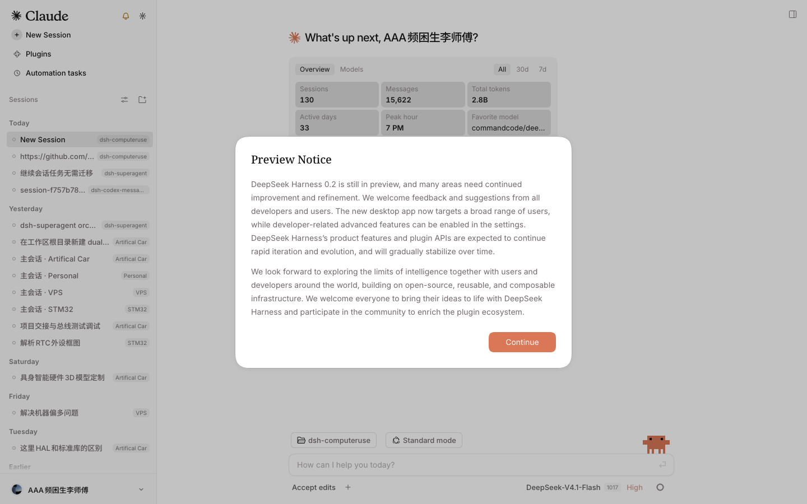

# dsh-codex-sidebar

DSH（DeepSeek Harness）左侧栏的「日期视图」插件：把会话列表按 **今天 / 昨天 / 星期X / 更早**
重新分段排列，顶行加一个铃铛按钮切换，齿轮直接跳到官方设置页里的「侧栏设置」。

拿到的是一个**独立插件**，不依赖任何主题或皮肤插件；装了 `dsh-claude-style` 时也能共存（见下）。


## 功能

- **按日期分段**：把宿主切到扁平分组，再按更新时间把会话重新排进日期段落，段落之间插标题。
- **运行中的会话强制「今天」并排在最前**：正在看的会话不会因为更新时间早而被埋进「更早」。
- **工作区标签**：扁平后没有分组标题了，每行右侧补一个工作区名标签，告诉你这个会话属于谁。
- **铃铛开关**：顶行铃铛切换日期视图；日期视图开着时常亮。有会话在跑时亮一个小绿点（不写数字）。
- **默认不接管**：装好后侧栏仍是宿主原本的工作区视图，只有按下铃铛才切到日期视图；选择会记住。
- **屏蔽工作区**：设置页里勾掉的工作区不进日期视图（默认屏蔽标题为 `闲聊` 的工作区）。
- **整体缩放**：5 个固定档位（85% / 90% / 100% / 110% / 120%）+ 自定义数字框。
- **设置进官方设置页**：三张卡片（日期视图、屏蔽工作区、整体缩放）注册成官方设置页的一个 section，不是自建浮层。
- **随界面语言**：段落标题与设置页文案跟随宿主语言（中文 / 英文）。


## 安装

插件目录就是本仓库，直接装到一个 DSH profile 里：

```bash
node scripts/install.mjs --profile codexprobe                     # 装
node scripts/install.mjs --profile codexprobe --uninstall        # 卸
```

脚本做三件事（都可手工完成）：

1. profile 的 `cordis.patch.yml` 里加一条 insert（id `ui-codex-sidebar`）；
2. profile 的 `package.json`：`dsh.profile.bundles` 里加 `dsh-codex-sidebar`，`dependencies` 里加 `"dsh-codex-sidebar": "link:<本目录>"`；
3. profile 的 `node_modules/dsh-codex-sidebar` 指向本目录的符号链接。

装完重启宿主生效。桌面 App 关窗不会退进程，要用 **Cmd+Q** 退出后重开。

> 桌面 App 自己管理的 profile（`desktop`）不能靠 `dsh --profile desktop` 启动，改了它的
> bundles 之后同样只能 Cmd+Q 重开。

## 与 dsh-claude-style 的共存

`dsh-claude-style` 主题里内置了一份同样的「铃铛 + 日期分组」特性，而且它接管了侧栏的工作区列表
渲染。两个插件同时移动同一批座位节点会互相打架，所以本插件按**三种模式**工作，启动后自动判定：

| 模式 | 什么时候 | 行为 |
| --- | --- | --- |
| `solo` | 没装主题 | 铃铛 + 齿轮，日期视图全功能 |
| `dormant` | 装了主题、未勾选接管 | 只挂齿轮（不碰列表、不挂铃铛），日期视图用主题自己那个 |
| `takeover` | 装了主题、勾选「由本插件接管日期视图」 | 藏掉主题的铃铛，由本插件提供日期视图 |

共存开关是设置页第一张卡片里的第二行，只在检测到主题时出现。

### 接管模式为什么要「借」主题的标记

主题把侧栏工作区列表换成了自己的 provider，它会盯着分组状态：一旦看到 `flat` 就认为不是自己写的，
立刻改回工作区。它只在 body 上存在 `data-dsh-claude-date-groups`（它自己日期视图开着的信号）时才放手。
所以接管时本插件会临时借用这个标记，让 `setGroupBy(flat)` 站住；退出日期视图时原样还回去。
如果主题当时自己正开着日期视图，会先按一次它的铃铛让它退出，再接管。



## 设置与持久化

设置存在 `localStorage["dsh-codex-sidebar.settings"]`：

| 键 | 类型 | 默认 | 说明 |
| --- | --- | --- | --- |
| `dateViewEnabled` | boolean | `false` | 启动时是否直接进日期视图；按铃铛会改写它 |
| `skipWorkspaces` | string[] | `["闲聊"]` | 不进日期视图的工作区**标题** |
| `zoom` | number | `1` | 整体缩放倍率（0.6 ~ 1.6） |
| `takeoverWithTheme` | boolean | `false` | 装了主题时是否由本插件接管日期视图 |

进入日期视图时宿主的分组方式会被切到 `flat`，原分组方式备份在
`localStorage["dsh-codex-sidebar.group-before-date-view"]`。进程被强杀导致残留扁平分组时，
下次启动会自动还原（只在备份还在、且当前确实仍是 `flat` 时才动手；`dormant` 模式下不动分组）。

## 开发

```bash
npm run build     # src/*.js → lib/client.js（esbuild 打包后套 __ModuleLoader__ 外壳）
npm run watch     # 持续构建
```

源码结构（每块一个文件，职责单一）：

| 文件 | 职责 |
| --- | --- |
| `src/entry.js` | 组装、MutationObserver 调度、三种共存模式的统一判定、启动自愈、卸载还原 |
| `src/constants.js` | 选择器、属性名、默认设置、档位 |
| `src/host-data.js` | 只读宿主 `sessions` / `workspaces` 服务 |
| `src/view-store.js` | 宿主侧栏视图 store：切扁平 / 还原分组 / 备份 |
| `src/sidebar-dom.js` | 侧栏 DOM 定位（`data-row-key`、座位 span、顶行） |
| `src/date-view.js` | 分段、排序、标题、工作区标签、开关 |
| `src/topbar.js` | 顶行铃铛与齿轮、运行中小绿点、铃铛可隐藏 |
| `src/settings-section.js` | 注册进官方设置页的 section 组件（日期视图 / 屏蔽工作区 / 缩放） |
| `src/open-settings.js` | 齿轮：打开官方设置页并跳到本插件那一页 |
| `src/settings.js` | localStorage 读写与订阅 |
| `src/locale.js` | 语言判定与文案 |
| `src/coexist.js` | 主题检测、模式判定、借用/退出主题日期视图 |
| `src/styles.js` | 插件自带样式（只给自有节点写样式） |

### 验证

`.debug/verify.mjs` 是 Playwright 直连的验证脚本（本机没有 Chrome，用的是 Playwright 自带
headless shell）：

```bash
# 1) 起一个装了插件的 profile
dsh --profile codexprobe --port 49800 --no-open > .debug/probe-web.log 2>&1 &
URL=$(grep -o "http://127.0.0.1:49800/?token=[^ ]*" .debug/probe-web.log | tail -1)

# 2) 跑一段页面内脚本并截图（脚本文件里可以有 top-level await）
env -u all_proxy -u ALL_PROXY -u http_proxy -u HTTP_PROXY -u https_proxy -u HTTPS_PROXY \
  PLAYWRIGHT_BROWSERS_PATH=$PWD/.playwright-browsers \
  node .debug/verify.mjs "$URL" <探针.mjs> <截图.png>
```

现成的探针：`.debug/eval-solo.js`（无主题，日期视图进出 + 设置页缩放）、`.debug/eval-theme.js`（装主题，dormant → takeover）、
`.debug/eval-theme-dismiss.js`（主题日期视图正开着时接管）、`.debug/eval-section-flow.js`（无主题的设置页全流程）、
`.debug/eval-theme-section.js`（有主题的设置页 + 接管）。

注意：token 一次性，每轮验证都要重启服务拿新 URL；环境里的 socks5 代理会掐断 WebSocket，必须
`env -u` 掉那几个变量。

## 已知限制

- 依赖宿主的 DOM 契约（`data-row-key`、`[data-slot="sidebar"]`、侧栏视图 store 的 `setGroupBy`），
  宿主大改版可能失效；类名是哈希的，只在兜底时才按子串匹配。
- 接管模式依赖 `dsh-claude-style` 的公开标记（`data-dsh-claude-date-groups`）与它的铃铛选择器；
  主题改版可能失效，失效时退化为 `dormant`（设置页里取消勾选即可）。
- 折叠成图标栏时不挂按钮（那里没有品牌按钮，硬塞会挤坏布局），展开后自动挂上。
- 归档视图打开时不进入日期视图（宿主在归档模式下会整体换列表，混排没有意义）。
- 日期视图里的行内工作区标签是插进宿主行 DOM 的，宿主重渲染后由下一帧补回（肉眼不可见）。

## 待办

- [ ] 日期段落之间加可折叠状态；
- [ ] 屏蔽规则支持按工作区 id（现在存标题，改标题会失配）；
- [ ] 设置页加「恢复默认」。
